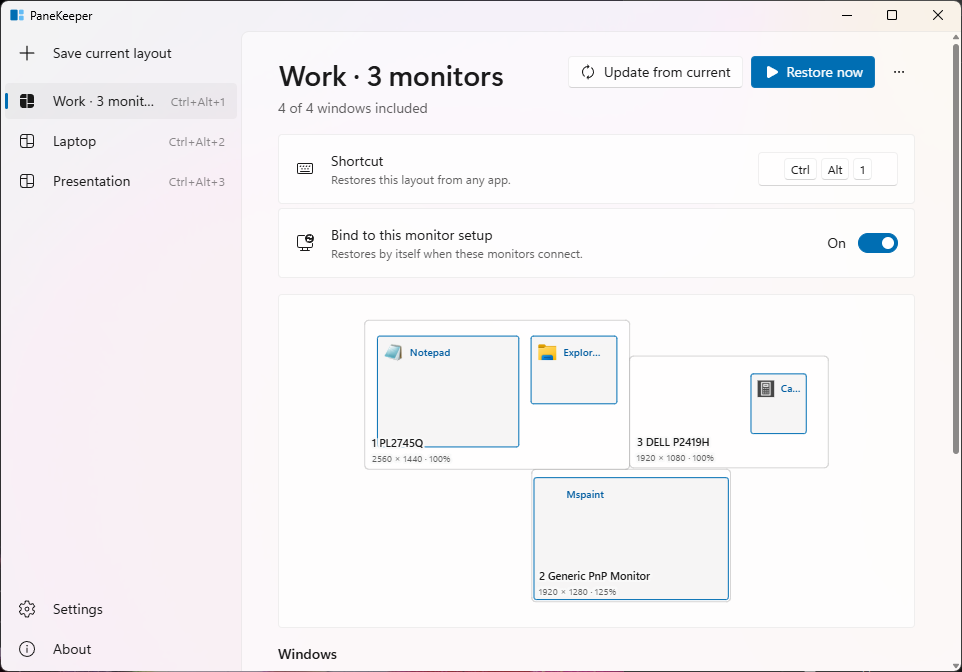
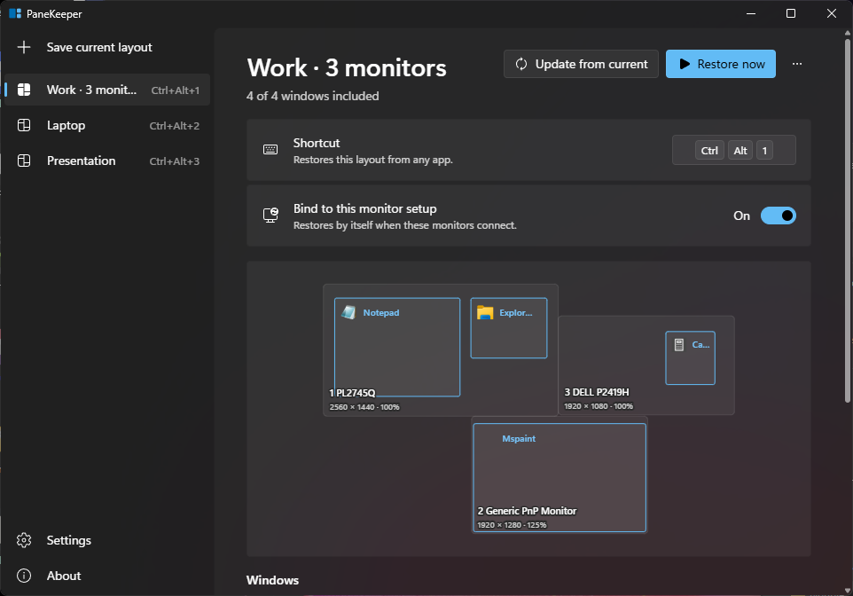

# PaneKeeper

Put every window back where it belongs, with one shortcut.

PaneKeeper saves the position, size and monitor of your app windows (browser, editor, chat, anything) as a named layout, and restores the whole layout when you press its shortcut. Built for multi-monitor desks: dock your laptop, press Ctrl+Alt+1, and everything is back.



<details><summary>Dark theme</summary>



</details>

## How to use

1. **Arrange your windows** the way you like them, on any monitor.
2. **Save current layout** (in the app, or from the tray icon). Give it a name such as "Work · 3 monitors" or "Laptop".
3. **Press the shortcut** to bring it back from any app. Layout 1 gets Ctrl+Alt+1, layout 2 Ctrl+Alt+2, and so on; click the shortcut field to pick your own.

The monitor map shows every monitor to scale, in its real arrangement, and every window where it will land. In the window list you choose which windows a layout includes, and whether PaneKeeper should **start an app that isn't running** (it waits for the window, then places it). Nothing is ever started unless you switched that on for that window.

Other things you can do:

- **Update from current** replaces a layout's windows with how they sit right now, keeping your include and launch choices.
- **Bind to this monitor setup** plus **Auto-restore on display change** (Settings) restores that layout by itself when those monitors connect.
- **Pause shortcuts** (tray or Settings) stops shortcuts and auto-restore; Restore now still works.
- **Start with Windows** puts PaneKeeper in the tray when you sign in.
- **Deleted a layout by mistake?** Undo it from the message that follows.
- **Polish and English**: window, tray menu and messages follow the Windows display language; switch it in Settings.
- Light and dark themes follow Windows, or pick one. On Windows 11 the window uses Mica.

## Multiple monitors

Each window remembers its monitor by the monitor's device id, not by its number in Display settings. Positions are DPI aware: a window saved on a 125% monitor lands right on a 100% one.

**A monitor that isn't connected** is drawn dashed on the map. Its windows are mapped proportionally onto the primary monitor, sized to fit, and never placed off-screen.

## Limits

- Windows of apps running **as administrator** can't be moved by a normal app (Windows blocks it, UIPI). They are reported as "blocked" after a restore; run PaneKeeper as administrator if you need them.
- Some apps (Store/UWP apps, some games and installers) restrict moving or resizing; PaneKeeper moves what Windows allows.
- **Virtual desktops** are not supported: save and restore layouts on the desktop you're using.
- Several windows of one app are told apart by their titles. If titles changed a lot since saving, two windows of the same app can swap places.

## Privacy

Everything stays on your PC: layouts are a JSON file in `%APPDATA%\PaneKeeper`. No account, no network access, no telemetry. PaneKeeper only reads and changes the position and size of top-level windows: it never closes windows, injects code or installs hooks into other apps, and it never asks for administrator rights.

## Install

Download `PaneKeeper_0.2.0_x64-setup.exe` from the [releases](https://github.com/prejas3/PaneKeeper/releases). It installs for your user only (no admin prompt), over 0.1.0 with your layouts kept, and needs Windows 10 or 11 with WebView2 (built in on Windows 11). Uninstalling removes the autostart entry; your layouts stay in `%APPDATA%\PaneKeeper` until you delete the folder.

## Development

Requirements: Node.js, Rust, the MSVC build tools, and the WebView2 runtime.

```powershell
npm install
npm run tauri dev       # run the app
npm run tauri build     # installer in src-tauri/target/release/bundle/nsis
```

Checks:

- `cargo test` in `src-tauri`: matching, DPI and border math, missing-monitor mapping, store, shortcuts.
- `cargo test -- --include-ignored`: also the live tests, which open, move and restore their own test windows (`src-tauri/examples/testwin.rs`).
- `npm run e2e`: drives the real release exe through WebView2 DevTools, with its data in a temp folder. It only ever moves its own test windows. `E2E_KEEP=1` keeps its screenshots.
- `npm run check:i18n`: every text exists in Polish and English, and no user-facing text sits outside the dictionaries (`src/i18n.ts`, `src-tauri/src/i18n.rs`).
- `npm run notices -- --check`: `THIRD_PARTY_LICENSES.txt` (shipped in the installer) matches the dependency graph.

## Licence

MIT, see [LICENSE](LICENSE). Third-party licences: [THIRD_PARTY.md](THIRD_PARTY.md), full texts in [THIRD_PARTY_LICENSES.txt](THIRD_PARTY_LICENSES.txt).
